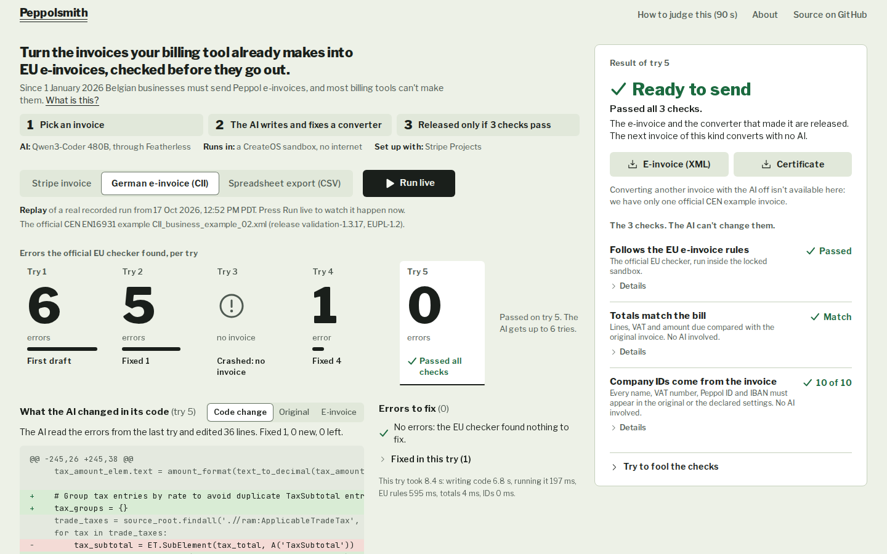

# Peppolsmith

The official validator checks that an invoice agrees with itself. Peppolsmith also checks that it agrees with what you billed.

**Live:** https://peppolsmith.vercel.app · **About, in plain words:** https://peppolsmith.vercel.app/about



## What it does

Belgian businesses have had to exchange structured e-invoices (Peppol BIS Billing 3.0, UBL XML) since 1 January 2026. Most billing data still lives in formats that aren't Peppol: a Stripe invoice, a billing app's CSV export, another standard such as UN/CEFACT CII.

Peppolsmith writes the missing converter:

1. **An agent writes `map.py`**: a small Python program that turns your source invoice into Peppol UBL.
2. **It runs in a CreateOS sandbox VM with the network off**, as an unprivileged user, with a 30 s limit.
3. **The official rules check the XML inside the VM.** These are the CEN EN16931 rules (validation-1.3.17) and the Peppol BIS Billing 3.0 rules (v3.0.20), pinned by sha256 and re-checked against a manifest before every run.
4. **Failed rule IDs go back to the model.** Each comes with the rule's official message, its XPath test and the XML the program wrote. The model replies with code edits. This repeats for up to 6 attempts.
5. **Two checks the model can't edit decide the release:**
   - **Reconciliation:** lines, net total, VAT per rate and amount due must tie to a human-written contract of the source invoice.
   - **Provenance:** every party name, VAT ID, Peppol ID and IBAN must come from the source or the declared trading-partner settings.
6. **The result is Certified or Held.** A certified converter then runs on new invoices of the same kind with no model call.

## What we measured (recorded runs, 17 Oct 2026)

| Source | Official rules failed, per attempt | Model calls | Model cost | Time |
|---|---|---|---|---|
| Official CEN example `CII_business_example_02.xml` (CII, not UBL) | 6, 5, no XML (crash), 1, **0: Certified** | 5 | $0.030 | 66 s |
| Stripe test-mode invoice `in_1URdBAFnAoogkMUBUiEf42JL` | malformed XML, 2, **0: Certified** | 3 | $0.022 | 54 s |
| Billing-app CSV export (European decimals, two VAT rates) | **0: Certified** at attempt 1 | 1 | $0.005 | 17 s |

- **Try to fool the gates.** We planted three converter bugs into the certified XML: amounts in cents treated as euros, a dropped document-level discount, and an invented buyer Peppol ID with a valid checksum. Each planted XML passes every official rule (0 failed), and each one is held by reconciliation or provenance. The page runs these live.
- **Model-off conversion.** The certified converters ran on a second Stripe test invoice (`in_1URda7FnAoogkMUB0KkjLgNg`) and a second CSV export. Both certified in about 1.7 s with 0 model calls.
- **Honest limits of the evidence:**
  - Across our 21 terminal runs, all 14 XMLs that passed the official rules also tied to their source. The gates never caught a real model slip; the planted bugs are the evidence that they would.
  - Convergence varies from run to run, as you'd expect from a model. These are all our 17 Oct runs since the fix feedback included the official XPath tests and the model's own XML:
    - CII example: 6 of 8 reached Certified within 6 attempts.
    - Stripe test invoice: 6 of 7 (including runs through the deployed page). The one that didn't stalled on a line-arithmetic rule (PEPPOL-EN16931-R120). That's why the fix prompt now adds a plain note for rules models often misread; every run since has certified.
    - CSV export: 1 of 1.
    - Nothing was ever released without all three checks passing.

## How it uses the sponsors

**CreateOS Sandbox**:
- **Where the model's code runs:** one `devbox:1` VM (1 vCPU, 1 GB) holds the validator: SaxonC-HE, the CEN XSLT and the compiled Peppol Schematron.
- **Network off:** a deny-by-default egress rule is set from the host, outside the VM, so `map.py` can't download anything.
- **Each run gets its own directory.** `map.py` runs as `nobody`; the orchestrator, not `map.py`, runs the validator after a `sha256sum -c MANIFEST` check.
- **Pause and resume:** the VM auto-pauses after 10 minutes and resumes in about 2.5 s with the validator already installed.
- **Not used:** fork, because the Free plan allows one sandbox.

**Stripe Projects**: the whole stack was provisioned from the Stripe CLI with `stripe projects add`:
- `createos/project`: runs the model's code (Free plan).
- `openrouter/api`: the fallback model route.
- `vercel/project`: hosts the page and API.
- the primary model's key, stored as a Stripe Projects variable (`featherless-api-key`).

`stripe projects env --pull` writes `.env`. The Stripe test invoices come from the Stripe API in test mode (`scripts/seed-stripe-invoice.sh`, which refuses to run outside a sandbox context).

## How to run

Requirements: Node.js 22+, the Stripe CLI with Stripe Projects, and accounts for the providers below.

```bash
npm install
stripe projects env --pull          # writes .env: CREATEOS_PROJECT_API_KEY, OPENROUTER_API_API_KEY, FEATHERLESS_API_KEY, VERCEL_*
npx tsx scripts/check-stack.ts      # one real call to CreateOS, Featherless and OpenRouter
npx tsx scripts/bootstrap-vm.ts --self-test   # creates or resumes the validator VM; official examples pass, a changed amount fails BR-CO-16
npx tsx scripts/run-sample.ts cii   # one full write → run → check → fix run in the terminal (also: stripe, csv)
npx tsx scripts/check-extras.ts     # planted bugs must be held; model-off conversion must certify
npm test                            # gates, sources, edit application, sandbox helpers
npm run dev                         # the page on http://localhost:3000
```

`--record` on `run-sample.ts` saves a run as `public/replay/<source>.json`. The page shows these recordings until you press **Run live**.

## Tech used

- **Next.js 16** (App Router) on Vercel, **TypeScript**, Tailwind CSS 4.
- **CreateOS Sandbox** via `@nodeops-createos/sandbox`, running Python 3.13 in the VM.
- **SaxonC-HE** (`saxonche`), CEN EN16931 validation-1.3.17 XSLT, OpenPeppol BIS Billing 3.0.20 Schematron compiled with the ISO Schematron skeleton.
- **Models:**
  - Qwen3-Coder-480B-A35B-Instruct on Featherless (primary).
  - DeepSeek-V3.2 on Featherless, then free OpenRouter models (fallbacks).
  - All through OpenAI-compatible chat completions.
- **Stripe Projects** for provisioning; the **Stripe API** (test mode) for the invoice sources.
- `fast-xml-parser` and `diff`, with vitest for tests.
- Built with Claude Code as the coding assistant. The models listed above are the ones the app itself calls.

## Layout

```
src/lib/agent.ts      the loop: write or fix map.py, run it in the VM, official rules, gates
src/lib/prompts.ts    what the model sees: source, declared settings, a Peppol reference; then rule failures and its own XML
src/lib/gates.ts      reconciliation and provenance (no model)
src/lib/sources.ts    the three sources and their human-written contracts
src/lib/sandbox.ts    CreateOS VM: bootstrap, egress lock, run map.py as nobody, hash-checked validator
src/lib/checks.ts     try-to-fool and model-off conversion
src/lib/sign.ts       live run logs are signed, so the API only continues runs it issued
vm/validate.py        in-VM validator (CEN XSLT + compiled Peppol Schematron, SVRL to JSON)
vm/fool.py            plants one converter bug while keeping the XML internally consistent
```

## Limits

- Passing the CEN and Peppol rules is not delivery over the Peppol network, which needs an access point.
- The samples are labelled in the app: one official CEN example (unmodified), Stripe test-mode invoices we created, and CSV rows we wrote. Seller and buyer IDs are fictional; the CII seller contact is our declared setting, because the example leaves it empty and Peppol's German rules require one.
- Live runs are limited to one at a time and 60 a day, so the public URL can't run up the model bill.

## Build window

- Planning, account setup and tool checks were done before the window. This includes linking the Stripe Projects providers and measuring the CreateOS VM in a throwaway sandbox.
- Every line of code in this repository was written after the window opened on 17 Oct 2026 at 12:00 PM PDT. The git history shows it.
